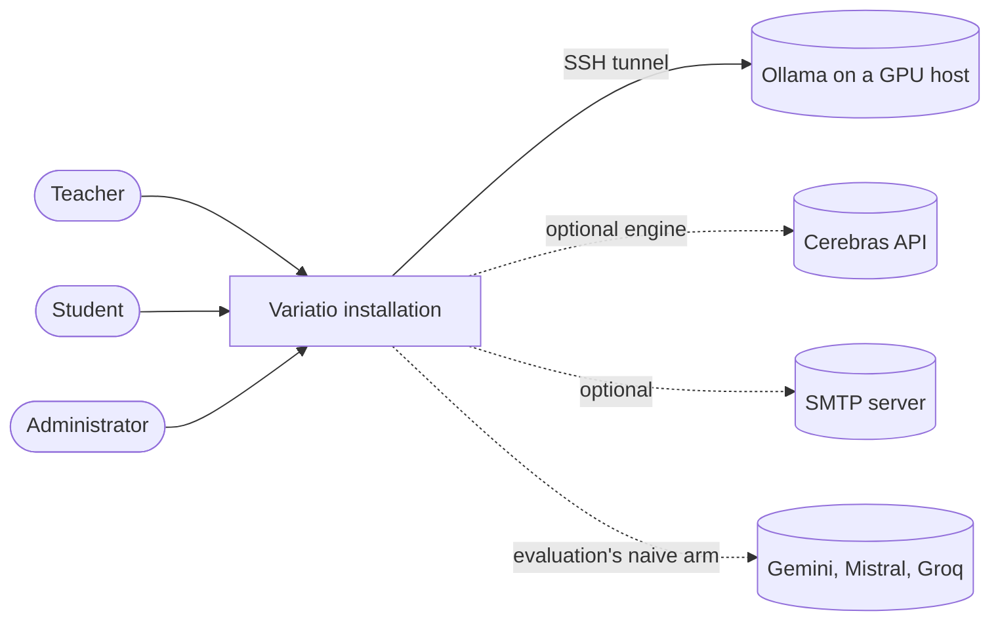
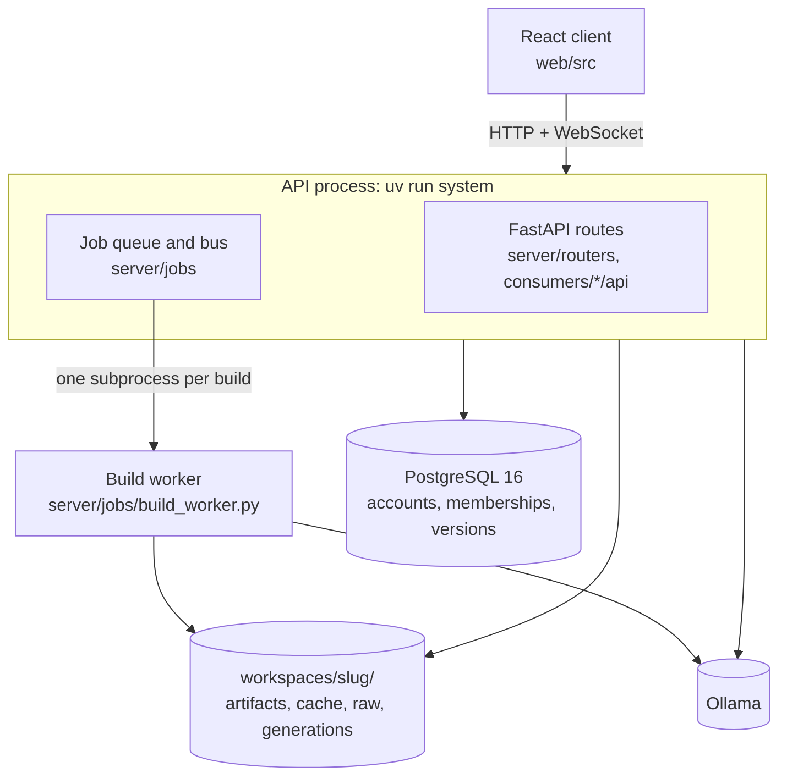

# Architecture

A map of the code for a person new to it: what each part holds, where to start reading, and
which rules hold everywhere. It names files and folders; it does not explain how each one
works — the package docstrings and the code do. Read `README.md` first to know what the
system is; read this second; then open the `__init__.py` of the package you need.

Every claim names the file, test or check that holds it. When the tree changes, this file
changes in the same commit.

## 1. Bird's-eye view

Variatio turns a teacher's documents into a subject the system can teach from, then uses that
subject to make new exercises and to talk to students.

- **The construction** reads a subject's raw documents (notes, exercises, exams) and builds
  three artifacts from them: the syllabus (a knowledge graph of concepts and relations), the
  types of exercise (the exemplars profile) and the bank (exemplars tagged by concept). A
  fourth, the subject's description (`content_context`), is written by two of the builders.
  Each artifact is a JSON file a teacher reviews, corrects and approves.
- **The functions** consume those artifacts: generating exercises, the Socratic tutor, the
  free chat and the blind evaluation of the system (the master's thesis study).
- **The library** (`variatio/`) does both kinds of work and knows no HTTP and no database. The
  **server** (`server/`) gives it accounts, subjects, a job queue and a database. The
  **functions** (`consumers/`) are packages that plug into the server. The **client**
  (`web/`) is a React application the server serves.
- Every model call goes through one engine boundary to Ollama (local, open weights) or,
  optionally, to Cerebras. The one exception is the evaluation's naive arm, which calls
  commercial APIs directly (`consumers/evaluation/arms/external.py`).

## 2. Glossary

The interface speaks Spanish; the code speaks English. One word per thing on each side.

| Interface (es) | Code (en) | Where |
|---|---|---|
| asignatura | workspace (`Workspace`, `slug`) | `variatio/core/workspace.py` |
| «Apuntes y ejercicios» (paso 1) | raw documents, two slots: `corpus` and `exemplars` | `raw/` of a workspace |
| «Temario» (paso 2) | knowledge graph, `kg` | `artifacts/knowledge_graph.json` |
| unidad | domain (`concepts_by_domains`) | the graph |
| concepto | concept, node | the graph |
| «sirve de etiqueta» | taggable (`generic_non_taggable_concepts`) | the graph |
| «Tipos de ejercicio» (paso 3, parte 1) | exemplars profile, modality, `item_type` | `artifacts/exemplars_profile.json` |
| «Banco de ejercicios» (paso 3, parte 2) | exemplars bank | `artifacts/exemplars_bank.json` |
| descripción de la asignatura | content context | `artifacts/content_context.json` |
| «Fase de construcción» / «Fase de pruebas» | `STEPS` / `USES` | `web/src/lib/steps.ts` |
| puerta | one entry of `USES` | `web/src/lib/steps.ts` |
| función | a package of `consumers/` | `consumers/` |
| encargo | commission: the parameters of a `generate` job | `consumers/generation/` |
| ejercicio generado | generation, variant | `server/generations.py` |
| «Avance de la asignatura» | curriculum | `server/curriculum.py` |
| «Clase» | members, groups, activity | `server/members.py`, `server/groups.py`, `server/activity.py` |
| alumno / docente / propietario | role `viewer` / `editor` / `owner` | `server/auth/deps.py` |
| perfil de la cuenta (Docente / Alumno) | `users.evaluator_profile` | `server/db/models.py` |
| carril | lane: `local` (Ollama) or `remote` (Cerebras) | `server/jobs/lanes.py` |
| «Administración» | the admin panel | `server/routers/admin.py`, `web/src/features/admin/` |

## 3. Context and containers

**Context.** Who uses the system and what it talks to.



**Containers.** What runs inside one installation.



- The API serves the client's build (`web/dist`) and owns the SSH tunnel (`server/core/tunnel.py`).
- A build runs in its own process because it lasts long and must be killable
  (`server/jobs/catalogue.py`, `SUBPROCESS_KINDS`). Everything else runs in the API's threads.
- **Files are the truth; the database mirrors them.** Artifacts are read from files and their
  versions are mirrored best-effort (`server/db/mirror.py`). The database is the truth for
  accounts, memberships, sessions, invitations and daily counts.
- The library's CLI (`uv run variatio`) runs the same pipeline with no API and no database.

## 4. The four parts and the direction of imports

```text
web/            React client         talks to the server over HTTP only
consumers/      the functions        imports server/ and variatio/
server/         API, queue, DB       imports variatio/
variatio/       the library          imports neither
```

- **`consumers` imports `variatio` and `server`; neither imports `consumers` back.** The
  exceptions are named one by one in the import contracts (`[tool.importlinter]` in
  `pyproject.toml`, `uv run lint-imports`): the settings registry's optional imports of each
  function's `settings.py`, and four reads of the evaluation older than `consumers/`
  (`server/jobs/lanes.py`, `server/jobs/handlers.py`, `server/raw_data.py`,
  `server/routers/admin.py`). No function imports another.
  `tests/consumers/test_consumers_boundary.py` pins that a function's library half imports
  neither FastAPI nor SQLAlchemy.
- **`import variatio` imports neither `server` nor Docling nor torch**, and it does not reach
  `core.inference` (measured: 116 ms). `tests/boundaries/test_light_import.py`.
- **Only `server/routing.py` imports a route module** (`server/routers/`,
  `server/core/routes/`), and the route modules do not import each other, but for the
  exceptions each contract names: the functions still use four routes as libraries.
- `import server` works with no database (`server/__init__.py`).
- The client reaches a function's code (`web/src/consumers/evaluation/`,
  `web/src/consumers/tutor/`) and the landing (`web/src/landing/`) only through `import()`;
  `pnpm check:lazy` checks the sources and, after `pnpm build`, the chunk graph.
- The client's imports go one way, app → features → components → state → lib, and a
  screen's folder imports no other screen's folder. `pnpm check:layers` checks it, with the
  imports of today against it named one by one; the list may only shrink.

**Inside `variatio/`.**

```text
entrypoints/                         the door: one function per thing asked of a workspace
builders/   runtime/   documents/    the work: raw → artifacts, artifacts → exercises, files → pages
loaders/  prompts/  wording/  settings/  core/      the vocabulary
```

- **`entrypoints/` is the library's public door.** `builders/` and `loaders/` take a
  `Workspace` only to resolve their own paths. `runtime/`, `prompts/`, `wording/` and
  `settings/` do not import it.
- **Inside `variatio/`, only `cli.py`, `builders/`, `runtime/`, `documents/` and `core/`
  import `core.inference`.** `documents/pages/` asks the vision model for each page;
  `core/repair.py` and `core/vectors.py` call it on behalf of `builders/` and `runtime/`.
  Outside the library the functions call it too (`consumers/tutor/`, `consumers/chat/`,
  `consumers/evaluation/`).
- The layers above are an import contract: `cli`, `entrypoints`, `builders | runtime`,
  `loaders | documents`, `prompts | wording`, then `core`, `settings` and `config`. Two crossings are
  named in it: `runtime/taggability.py` imports the graph builder's node block and parser
  (`blocks`, `parsing`), and `core/lexicon.py` imports `wording/`. The two rules above and
  «only `core/ollama.py`, the local engine, imports the Ollama SDK» are contracts too.

**Inside `server/`.**

```text
app.py  routing.py  cli/                  composition
routers/                                  the routes, which only routing.py imports
auth/                                     identity and permissions
jobs/  conversations/  generations.py     the queue, what the tutor and the chat share, the exercises
core/                                     what every area stands on
db/                                       models, session, mirror
```

- The order is an import contract («The server's layers»). A route module is a leaf wherever
  it lives (`routers/`, `core/routes/`, `conversations/routes.py`), so what it imports is out
  of the order. The modules still at the server's root are outside it until their areas
  exist (D-227).

## 5. Code map

One line per folder: what it holds, and the file to open first.

**Library: `variatio/`**

| Folder | Holds | Start at |
|---|---|---|
| `variatio/` (root) | `cli.py`, `config.py`, `__init__.py` (logging) and nothing else | `cli.py` |
| `core/` | the engine boundary (`inference.py`) and its engines (`ollama.py`, `cerebras.py`, `cerebras_budget.py`), batched embedding (`vectors.py`), paths, `Workspace`, progress, JSON I/O, repair, usage meters | `workspace.py`, then `inference.py` |
| `settings/` | the settings registry, its store (`config.json`) and derived values | `registry/__init__.py` |
| `loaders/` | readers of the artifacts: graph, profile, context, relations, locale | `knowledge_graph.py` |
| `prompts/` | the library's two prompt sets, `es/` and `en/`, same modules and signatures, and `marks.py`, shared by both; each function keeps its own in `consumers/<function>/prompts/` | `prompts/__init__.py` |
| `wording/` | strings the code composes in the workspace's language | `wording/__init__.py` |
| `builders/` | raw → artifacts: the graph, profile and bank builders, the context synthesis | `knowledge_graph_builder/__init__.py` |
| `documents/` | document plumbing: files, markdown, chunking, page transcription (`pages/`, a package by step), Office | `files.py`, then `pages/__init__.py` |
| `runtime/` | artifacts → exercises: generator, tagger, taggability, checks | `generator.py` |
| `runtime/embedder/` | concept descriptions and the two vector indices | `embedder/__init__.py` |
| `runtime/screening/` | the guardrail and the admissibility judge | `screening/__init__.py` |
| `entrypoints/` | `transcribe`, `build`, `initialize`, `generate`, `taggability`, `descriptions`, `tag` | `entrypoints/__init__.py` |

**Server: `server/`**

| Folder | Holds | Start at |
|---|---|---|
| `server/` (root) | `app.py` (composition root), `routing.py` (the order of the routes) and 14 domain modules: `approvals`, `storage`, `singletons` (the process's instances), `members`, `groups`, `activity`, `curriculum`, `features`, `raw_data`, `originals`, `generations`, … | `app.py` |
| `core/` | what every area stands on: the warm contexts, resolving a subject, the environment, the tunnel, model downloads, the maintenance door, the middleware, days and weeks, CSV cells; `routes/` holds `/api/health`, `/api/maintenance` and the WebSocket stream | `core/__init__.py` |
| `routers/` | the server's own HTTP routes, one module per URL prefix or screen; `routing.py` holds the order they are mounted in (`ROUTERS`), and `app.py` mounts the generation's routes before them and the other functions' after them | `routing.py`, then `app.py` |
| `editors/` | hand edits of the artifacts: graph, profile, bank, context | `bank_edit.py` |
| `auth/` | route guards (`deps.py`), passwords, tokens, sealed links, mail, rate limits | `deps.py` |
| `db/` | ORM models, session, schema check, mirror, import/export, identity queries | `models.py` |
| `jobs/` | the queue: catalogue, runner, lanes, priority, bus, handlers, chains, build worker | `catalogue.py`, then `runner.py` |
| `conversations/` | what the tutor and the chat share: store, daily count, quiet stream, route half | `store.py` |
| `cli/` | the `system` command | `main.py` |

**Functions: `consumers/`** — each package has a library half (no FastAPI, no SQLAlchemy) and
an `api/` package whose `install(app)` the composition root calls.

| Folder | Holds | Start at |
|---|---|---|
| `consumers/generation/` | the commission: its routes, the `generate` job and its bounds | `api/__init__.py` |
| `consumers/evaluation/` | the study: arms, sessions, instruments, statistics | `run.py` |
| `consumers/tutor/` | the Socratic tutor: card, turn, focus, checks, criteria, digest | `turn.py` |
| `consumers/chat/` | the free chat: one guarded call per turn | `turn.py` |

**Client: `web/`**

| Folder | Holds | Start at |
|---|---|---|
| `web/src/` (root) | `main.tsx` (boot), `App.tsx` (routes), `index.css` (tokens) | `App.tsx` |
| `components/` | shared screens' parts: `AppShell`, `StageGate`, `BuildButton`, … | `StageGate.tsx` |
| `components/ui/` | primitives (shadcn names): button, card, table, dialog, … | `web/DESIGN.md` |
| `features/` | one folder per screen of the core: `raw`, `kg`, `profile`, `bank`, `class`, `admin`, `auth`, `account`, `workspaces`, … | the screen's `*Screen.tsx` |
| `consumers/` | one folder per function, mirroring `consumers/` | the function's screen |
| `landing/` | the public front page and the demo over an in-memory server | `LandingScreen.tsx` |
| `lib/` | pure helpers, the API client, the router, i18n catalogues, the API types | `steps.ts`, `api.ts` |
| `state/` | data hooks (`queries.ts`), the run store, the session, the tab's workspace | `queries.ts` |
| `scripts/` | the four `check:*` gates | — |

**Elsewhere**

| Folder | Holds |
|---|---|
| `migrations/` | Alembic migrations; the ORM models must match them |
| `tests/` | one folder per subsystem (`core`, `settings`, `loaders`, `prompts`, `builders`, `generation`, `screening`, `server`, `consumers/<function>`); `conftest.py` and `fixtures/` at the root |
| `workspaces/` | the instances, one folder per slug (git-ignored) |
| `plans/` | private work plans (git-ignored) |

## 6. Area map

Where each part of the product lives, across the four parts. "—" means the area has nothing
there.

| Area | Client | Server | Library | Jobs | Tests |
|---|---|---|---|---|---|
| Step 1 «Apuntes y ejercicios» | `features/raw/` | `routers/raw.py`, `raw_data.py`, `originals.py` | `documents/`, `entrypoints/transcribe.py` | `transcribe` | `tests/server/test_raw_*`, `tests/builders/` |
| Step 2 «Temario» | `features/kg/` | `routers/kg.py`, `kg_view.py`, `editors/kg_edit.py` | `builders/knowledge_graph_builder/`, `loaders/knowledge_graph.py`, `runtime/embedder/` | `build_kg`, `describe_concepts` | `tests/builders/`, `tests/server/test_kg_*` |
| Step 3 «Banco de ejercicios» | `features/bank/`, `features/profile/` | `routers/bank.py`, `routers/profile.py`, `routers/exercises.py`, `editors/bank_edit.py`, `editors/profile_edit.py`, `bank_marks.py`, `taggability.py` | `builders/exemplars_bank_builder.py`, `builders/exemplars_profile_builder.py`, `runtime/tagger.py`, `runtime/taggability.py`, `loaders/exemplars_profile.py` | `review_taggability`, `build_profile`, `build_bank`, `index`, `tag`, `tag_item` | `tests/server/test_bank_*`, `tests/generation/test_taggability*` |
| The bar and approvals | `lib/steps.ts`, `components/StageGate.tsx` | `approvals.py`, `storage.py`, `jobs/chain.py`, `jobs/handlers.py`, `routers/pipeline.py` | — | the chains of the three steps | `tests/server/test_chain_gates.py`, `tests/server/test_job_chains.py` |
| Generating | `consumers/generation/` | `consumers/generation/`, `generations.py` | `runtime/generator.py`, `runtime/checks.py`, `runtime/screening/`, `entrypoints/generate.py` | `generate` | `tests/consumers/generation/`, `tests/generation/`, `tests/screening/` |
| «Clase» | `features/class/` | `members.py`, `groups.py`, `activity.py`, `curriculum.py`, `routers/members.py`, `routers/activity.py`, `routers/kg.py` (the progress's `GET`/`PUT /api/kg/curriculum`) | — | `activity_digest` (the tutor's) | `tests/server/test_class_*`, `tests/server/test_course_progress.py` |
| Tutor | `consumers/tutor/` | `consumers/tutor/`, `conversations/` | the embedder, and the guardrail on the student's message (`consumers/tutor/checks.py` checks the reply) | `tutor_turn`, `tutor_criteria`, `activity_digest` | `tests/consumers/tutor/` |
| Free chat | `consumers/chat/` | `consumers/chat/`, `conversations/` | the guardrail on the student's message | `chat_turn` | `tests/consumers/chat/` |
| Evaluation | `consumers/evaluation/` | `consumers/evaluation/` | the whole pipeline, as the `system` arm | `evaluate` | `tests/consumers/evaluation/` |
| Accounts and subjects | `features/auth/`, `features/account/`, `features/workspaces/` | `auth/`, `routers/auth.py`, `routers/workspaces.py`, `db/identity.py`, `features.py`, `core/installation.py`, `core/environment.py` | — | — | `tests/server/test_invite_*`, `tests/server/test_workspace_*`, `tests/server/test_login_rate_limit.py` |
| Administration | `features/admin/`, `features/maintenance/` | `routers/admin.py`, `routers/admin_engine.py`, `routers/config.py`, `core/routes/maintenance.py`, `core/routes/health.py` | `settings/` | — | `tests/server/test_admin_*`, `tests/settings/` |
| Landing and demo | `landing/` | — | — | simulated in `landing/demo/jobs.ts` | `landing/**/*.test.ts` |

Client paths are under `web/src/`; server paths under `server/` unless they start with
`consumers/`; library paths under `variatio/`.

## 7. Invariants

Each rule holds everywhere. The check after it is what fails when the rule breaks.

- **The import boundaries of section 4.** `uv run lint-imports` (also run by
  `tests/boundaries/test_import_contracts.py`) and `pnpm check:layers`.
- **Every package has a docstring**, its front page. `tests/boundaries/test_package_docstrings.py`.
- **There is no default workspace**: every path takes one; `paths.workspace("")` raises.
  `tests/server/test_no_default_workspace.py`.
- **One writer of persisted JSON**, `core/json_io.write_json` (atomic; approval hashes are
  hashes of its bytes). `tests/core/test_json_io_atomic.py` tests the writer; the rule itself
  is a convention.
- **Every route declares its access level**, and a new route with no row fails.
  `tests/server/test_route_roles.py`.
- **A fixed route sits above any wildcard that could swallow it**, in every router.
  `tests/consumers/evaluation/test_route_order.py`.
- **A private job is its author's alone** (`catalogue.PRIVATE_KINDS`).
  `tests/server/test_private_jobs.py`.
- **Every setting names the stages that read it.** `tests/settings/test_setting_stages.py`.
- **The library's two prompt sets have the same modules and signatures.**
  `tests/prompts/test_prompt_sets.py` (the functions' prompt sets are not covered).
- **Every PDFium call holds one process-wide lock.** `tests/builders/test_pdfium_lock.py`.
- **No header raises the Cerebras ceilings.** `tests/core/test_cerebras_budget.py`.
- **The ORM models describe what the migrations built**: `alembic` autogenerate against the
  live schema reports zero differences. Checked by hand; `serve` refuses a schema behind or
  ahead of the migrations (`server/db/schema.py`).
- **Every client string is in the catalogue, in both languages.** `pnpm check:i18n`, `tsc`.
- **No white, and every colour pair is measured.** `pnpm check:color`.
- **No raw scale sizes, unlabelled controls or raw tables.** `pnpm check:ui`.

## 8. Cross-cutting concerns

- **Subjects and paths.** A `Workspace` (`variatio/core/workspace.py`) is a frozen dataclass
  that derives every path of one subject from its root. `paths.workspace(slug)` is the one
  door that opens one. The server resolves the request's subject once (`X-Workspace`) in
  `server/auth/deps.py` and hands `Access.ws` down.
- **Settings.** `variatio/config.py` is an index of names; the values are declared in
  `variatio/settings/registry/` with their measured `doc` and `Impact`. Precedence: default <
  `config.json` < environment. Code reads `config.X` by module attribute, never
  `from config import X`, because the panel rewrites values while the API runs.
- **The queue.** A job (`server/jobs/catalogue.py`) waits on a lane (`server/jobs/lanes.py`):
  `local` has capacity 1, `remote` a setting. Inside a lane, three classes by who waits
  (`server/jobs/priority.py`). The runner (`server/jobs/runner.py`) runs a handler from
  `catalogue.HANDLERS` (the construction's from `server/jobs/handlers.py`) and the bus (`server/jobs/bus.py`) carries its events
  to the WebSocket. Every model call of the API goes through a job, because the idle unload
  (`server/jobs/idle.py`) reads only the queue.
- **How a function plugs in.** `server/app.py` calls each function's `api.install(app)`. It
  mounts the function's routes and adds its kinds to the server's tables, all in
  `server/jobs/catalogue.py`: `HANDLERS`, `FEATURE_OF`, `ADMISSIONS`, `PRIVATE_KINDS`,
  `STUDENT_KINDS` and `JOB_CLASS` (`server/jobs/priority.py` reads the class); its models in `EXTRA_MODELS` (`server/jobs/lanes.py`); and,
  for the tutor and the chat, the class activity's readers (`server/activity.py`,
  `TUTOR_READER`, `CHAT_READER`). Its settings come in by the registry's optional import.
- **Identity and roles.** Own accounts and sessions (`server/auth/`), invitation-only. Every
  route checks a membership row: `auth.VIEW`, `EDIT` or `MANAGE` (`server/auth/deps.py`); the
  administrator's bypass lives there alone. An optional function adds its own guard
  (`server/features.py`).
- **Model calls.** One boundary, `variatio/core/inference.py` (`generate()`, `embed()`,
  `embed_batch()`), over two engines: `core/ollama.py` (local) and `core/cerebras.py` (hybrid).
  Business code never calls an SDK; the evaluation's naive arm alone calls commercial APIs
  over `httpx`, outside the boundary, because it measures them. Every call has its own model,
  reasoning and sampling per phase. `variatio/core/usage.py` counts the tokens of every job.
- **Logging.** loguru, configured once in `variatio/__init__.py`. `variatio/` logs in
  English; `server/` and `consumers/` in Spanish. Format `[scope] Message`. A job logs to
  `logs/<slug>/jobs.log`.
- **Languages.** Three axes: the interface language is the account's (`web/src/lib/i18n/`),
  the prompt language is the workspace's (`artifacts/locale.json`, `variatio/prompts/`,
  `variatio/wording/`), and the language of instruction is the corpus's
  (`content_context.json`).

## 9. Where to go next

- `AGENTS.md`: the rules that hold everywhere, and the index of the `AGENTS.md` beside each
  folder with rules of its own (`variatio/`, `server/`, `consumers/<function>/`, `web/`, …).
- `DECISIONS.md`: the register of closed decisions, each with its date, commit and reason.
- `web/DESIGN.md`: the rulebook for every element of the interface.
- The docstring of each package's `__init__.py`: what it holds and its modules.
- `README.md`: what the system does and how to start it.
