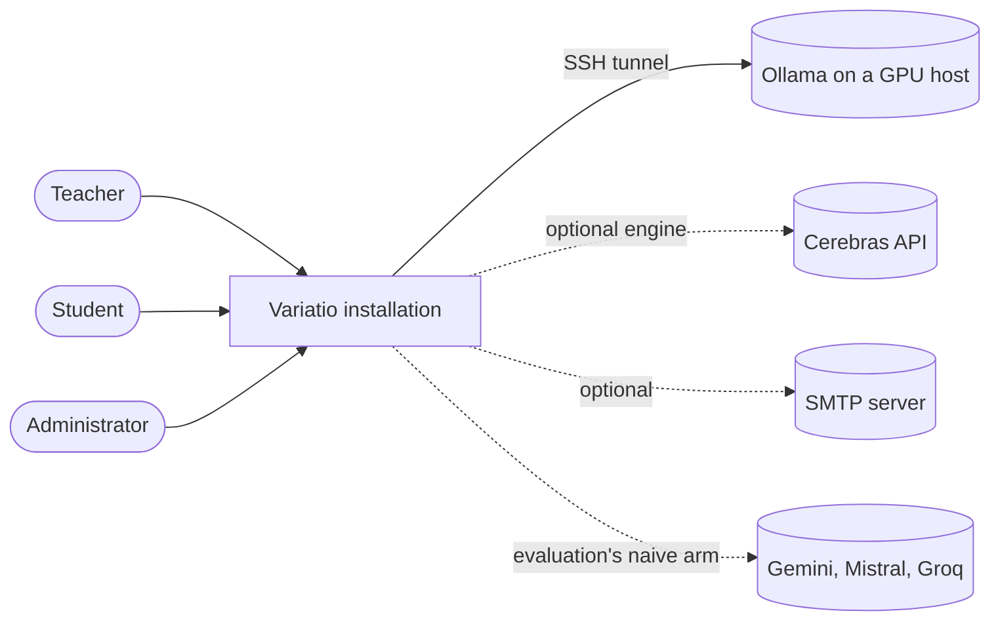
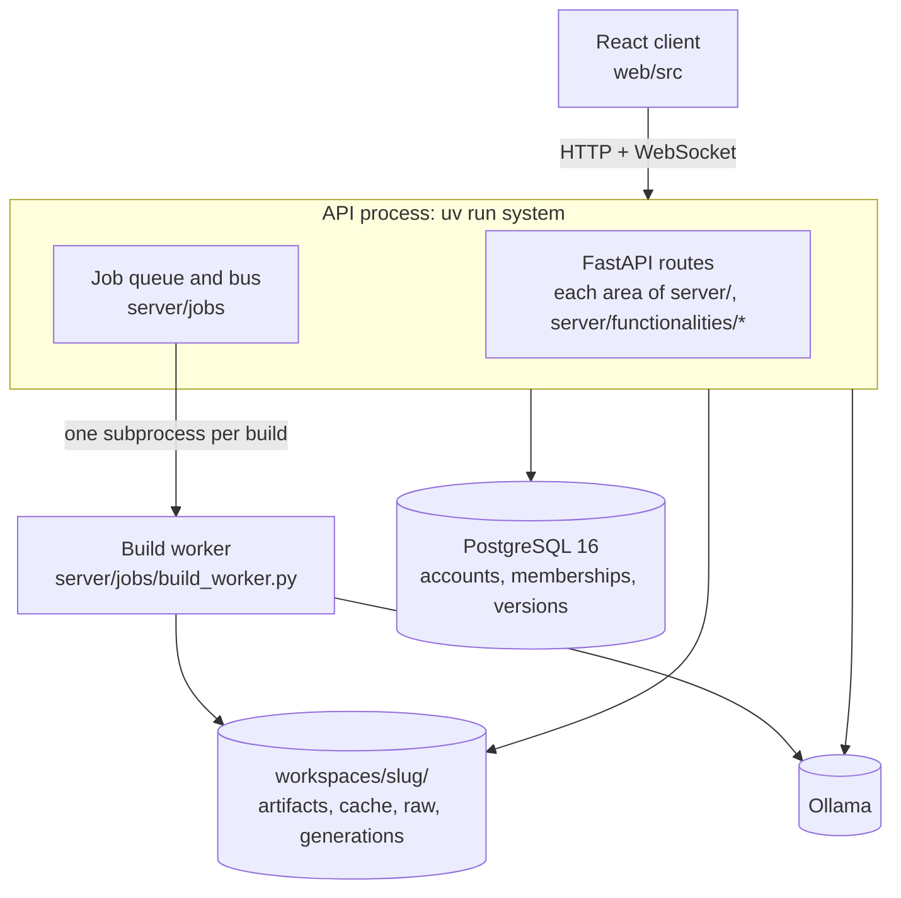

# Architecture

A map of the code for a person new to it: what each part holds, where to start reading, and
which rules hold everywhere. It names files and folders; it does not explain how each one
works — the package docstrings and the code do. Read `README.md` first to know what the
system is; read this second; then open the `__init__.py` of the package you need.

Every claim names the file, test or check that holds it. When the tree changes, this file
changes in the same commit.

## 1. Bird's-eye view

Variatio turns a teacher's documents into a subject the system can teach from, then uses that
subject to make new exercises and to talk to students.

- **The construction** reads a subject's raw documents (notes, exercises, exams) and builds
  three artifacts from them: the syllabus (a knowledge graph of concepts and relations), the
  types of exercise (the exemplars profile) and the bank (exemplars tagged by concept). A
  fourth, the subject's description (`content_context`), is written by two of the builders.
  Each artifact is a JSON file a teacher reviews, corrects and approves.
- **The functions** consume those artifacts: generating exercises, the Socratic tutor, the
  free chat and the blind evaluation of the system (the master's thesis study).
- **The library** (`variatio/`) does both kinds of work and knows no HTTP and no database. The
  **server** (`server/`) gives it accounts, subjects, a job queue and a database. The
  **functions** (generation, tutor, chat, evaluation) each have a library half
  (`variatio/functionalities/`) and a server half (`server/functionalities/`) that plugs into
  the server. The **client**
  (`web/`) is a React application the server serves.
- Every model call goes through one engine boundary to Ollama (local, open weights) or,
  optionally, to Cerebras. The one exception is the evaluation's naive arm, which calls
  commercial APIs directly (`variatio/functionalities/evaluation/arms/external.py`).

## 2. Glossary

The interface speaks Spanish; the code speaks English. One word per thing on each side.

| Interface (es) | Code (en) | Where |
|---|---|---|
| asignatura | workspace (`Workspace`, `slug`) | `variatio/utils/workspace.py` |
| «Apuntes y ejercicios» (paso 1) | raw documents, two slots: `corpus` and `exemplars` | `raw/` of a workspace |
| «Temario» (paso 2) | knowledge graph, `kg` | `artifacts/knowledge_graph.json` |
| unidad | domain (`concepts_by_domains`) | the graph |
| concepto | concept, node | the graph |
| «sirve de etiqueta» | taggable (`generic_non_taggable_concepts`) | the graph |
| «Tipos de ejercicio» (paso 3, parte 1) | exemplars profile, modality, `item_type` | `artifacts/exemplars_profile.json` |
| «Banco de ejercicios» (paso 3, parte 2) | exemplars bank | `artifacts/exemplars_bank.json` |
| descripción de la asignatura | content context | `artifacts/content_context.json` |
| «Fase de construcción» / «Fase de pruebas» | `STEPS` / `USES` | `web/src/lib/steps.ts` |
| puerta | one entry of `USES` | `web/src/lib/steps.ts` |
| función | a package of `functionalities/`, in the library and in the server | `variatio/functionalities/`, `server/functionalities/` |
| encargo | commission: the parameters of a `generate` job | `server/functionalities/generation/` |
| ejercicio generado | generation, variant | `server/functionalities/shared/generations.py` |
| «Avance de la asignatura» | curriculum | `server/classroom/curriculum.py` |
| «Clase» | members, groups, activity | `server/classroom/` |
| alumno / docente / propietario | role `viewer` / `editor` / `owner` | `server/auth/deps.py` |
| perfil de la cuenta (Docente / Alumno) | `users.evaluator_profile` | `server/db/models.py` |
| carril | lane: `local` (Ollama) or `remote` (Cerebras) | `server/jobs/lanes.py` |
| «Administración» | the admin panel | `server/admin/`, `web/src/features/admin/` |

## 3. Context and containers

**Context.** Who uses the system and what it talks to.



**Containers.** What runs inside one installation.



- The API serves the client's build (`web/dist`) and owns the SSH tunnel (`server/core/tunnel.py`).
- A build runs in its own process because it lasts long and must be killable
  (`server/jobs/catalogue.py`, `SUBPROCESS_KINDS`). Everything else runs in the API's threads.
- **Files are the truth; the database mirrors them.** Artifacts are read from files and their
  versions are mirrored best-effort (`server/db/mirror.py`). The database is the truth for
  accounts, memberships, sessions, invitations and daily counts.
- The library's CLI (`uv run variatio`) runs the same pipeline with no API and no database.

## 4. The three parts and the direction of imports

```text
web/            React client         talks to the server over HTTP only
server/         API, queue, DB       imports variatio/
variatio/       the library          imports neither
```

- **`server` imports `variatio`; `variatio` never imports `server`.** Each function is split
  the same way: its library half in `variatio/functionalities/<function>/` (no FastAPI, no
  SQLAlchemy) and its server half in `server/functionalities/<function>/`, whose `install(app)`
  the composition root calls. No function imports another; what several use lives in
  `functionalities/shared/` on each side. The exceptions are named one by one in the import
  contracts (`[tool.importlinter]` in `pyproject.toml`, `uv run lint-imports`): the settings
  registry's optional imports of each function's `settings.py`, and the evaluation, which runs
  the whole system through `variatio.api` and reuses the generator.
  `tests/functionalities/test_functions_boundary.py` pins that a function's library half imports
  neither FastAPI nor SQLAlchemy.
- **`import variatio` imports neither `server` nor Docling nor torch**, and it does not reach
  `inference/` (measured: 116 ms). `tests/boundaries/test_light_import.py`.
- **Only `server/routing.py` imports a route module** (an area's `router.py` or `routes/`, and
  the panel's modules), and the route modules do not import each other. Neither contract has
  an exception: a function reads an area's services, never its routes.
- `import server` works with no database (`server/__init__.py`).
- The client reaches a function's code (`web/src/consumers/evaluation/`,
  `web/src/consumers/tutor/`) and the landing (`web/src/landing/`) only through `import()`;
  `pnpm check:lazy` checks the sources and, after `pnpm build`, the chunk graph.
- The client's imports go one way, app → features → components → state → lib, and a
  screen's folder imports no other screen's folder. `pnpm check:layers` checks it, with the
  imports of today against it named one by one; the list may only shrink.

**Inside `variatio/`.**

```text
api/                                 the door: one function per thing asked of a workspace
knowledge_graph/   exemplars_bank/   the artifacts: each one's class, its build and its readers
functionalities/   documents/        the work: artifacts → exercises, files → pages
retrieval/                           the two vector indices the work searches
prompts/  settings/  utils/          the vocabulary
inference/                           the engine boundary: every model call
```

- **`api/` is the library's public door.** The builds (`knowledge_graph/build/`,
  `exemplars_bank/build.py`, `exemplars_bank/exemplars_profile/build.py`) take a
  `Workspace` only to resolve their own paths. `functionalities/`, `retrieval/`, `prompts/` and
  `settings/` do not import it.
- **Inside `variatio/`, only `cli.py`, `functionalities/`, `retrieval/`, `documents/`,
  `exemplars_bank/` (not its reader `exemplars_profile/profile.py`) and `knowledge_graph/` (not its readers `graph.py`, `context.py` and `relations.py`) import `inference/`.** `documents/pages/` asks the vision model for each page;
  `inference/repair.py` and `inference/vectors.py` call it on behalf of the builds and the functions.
  Outside the library the functions call it too (`variatio/functionalities/tutor/`, `functionalities/chat/`,
  `variatio/functionalities/evaluation/`).
- The layers above are an import contract: `cli`, `api`, `functionalities`,
  `exemplars_bank`, `retrieval`, `knowledge_graph`, `documents`, `prompts`, `inference`, then `utils`, `settings` and
  `config`. One crossing is named in it: `utils/lexicon.py` imports `prompts/wording.py`. The two rules above and
  «only `inference/ollama.py`, the local engine, imports the Ollama SDK» are contracts too.

**Inside `server/`.**

```text
app.py  routing.py  cli/                  composition
admin/                                    the panel: one route module per tab
bank/  kg/  raw/                          step 3, the bank; step 2, the syllabus; step 1, the raw documents
classroom/                                «Clase»: people, groups, progress, activity
pipeline/                                 the chain of the three steps
auth/  workspaces/                        identity and permissions; the subjects of an account
functionalities/shared/                   what the tutor and the chat share; the exercises
core/                                     what every area stands on, the live queue among it
jobs/                                     the queue's machinery
db/                                       models, session, mirror
```

- The order is an import contract («The server's layers»). A route module is a leaf wherever
  it lives (an area's `router.py` or `routes/`, the panel's modules,
  `functionalities/shared/conversations/routes.py`), and so are the construction's jobs (`pipeline/jobs.py`): what
  they import is out of the order. Every module of the server is in it (D-227).

## 5. Code map

One line per folder: what it holds, and the file to open first.

**Library: `variatio/`**

| Folder | Holds | Start at |
|---|---|---|
| `variatio/` (root) | `cli.py`, `config.py`, `__init__.py` (logging) and nothing else | `cli.py` |
| `inference/` | the engine boundary (`__init__.py`) and its engines (`ollama.py`, `cerebras.py`, `cerebras_budget.py`), batched embedding (`vectors.py`), repair, usage meters | `__init__.py` |
| `utils/` | paths, `Workspace`, progress, JSON I/O, languages, the workspace's language (`locale.py`), lexicon, repetition, dotenv | `workspace.py` |
| `settings/` | the settings registry, its store (`config.json`) and derived values | `registry/__init__.py` |
| `knowledge_graph/` | the graph (`graph.py`, `KnowledgeGraph`), the subject's context (`context.py`, `ContentContext`), the relation vocabulary (`relations.py`), their build (`build/`: extract, clean, curate, and the context synthesis), the concept descriptions and the taggability review | `__init__.py`, then `build/__init__.py` |
| `exemplars_bank/` | the bank's build (`build.py`) and tagging (`tagging.py`, `ConceptTagger`); the profile in `exemplars_profile/` (`profile.py`, `ExemplarsProfile`; `build.py`) | `__init__.py`, then `build.py` |
| `prompts/` | the library's two prompt sets, `es/` and `en/`, same modules and signatures, each with its `wording.py` (the strings the code composes in the workspace's language) and its `conversation.py` (the blocks of a chat-like system prompt); `marks.py` and `shared.py`, shared by both; the tutor's, the chat's and the evaluation's prompts are `es/<function>.py` and `en/<function>.py`, resolved by `<function>.py` | `prompts/__init__.py`, `prompts/wording.py` |
| `documents/` | document plumbing: files, markdown, chunking, page transcription (`pages/`, a package by step), Office | `files.py`, then `pages/__init__.py` |
| `functionalities/generation/` | artifacts → exercises: generator, checks | `generator.py` |
| `retrieval/` | the two vector indices (`Embedder`) and their caches | `index.py` |
| `functionalities/shared/screening/` | the guardrail and the admissibility judge, used by several functions | `screening/__init__.py` |
| `functionalities/chat/` | the free chat's library half: one guarded call per turn | `turn.py` |
| `functionalities/tutor/` | the Socratic tutor's library half: card, turn, focus, checks, criteria, digest | `turn.py` |
| `functionalities/evaluation/` | the study's library half: arms, sessions, statistics | `run.py` |
| `api/` | `transcribe`, `build`, `initialize`, `generate`, `taggability`, `descriptions`, `tag` | `api/__init__.py` |

**Server: `server/`**

| Folder | Holds | Start at |
|---|---|---|
| `server/` (root) | `app.py` (composition root), `routing.py` (the order the areas' routes are mounted in; `app.py` mounts the generation's before them and the other functions' after them) | `routing.py`, then `app.py` |
| `core/` | what every area stands on: the process's live pieces (`process.py`: the bus, the queue, the tunnel, the downloads), the warm contexts, resolving a subject, the environment, the tunnel, model downloads, the maintenance door, the middleware, days and weeks, CSV cells; `routes/` holds `/api/health`, `/api/maintenance` and the WebSocket stream | `core/__init__.py` |
| `admin/` | the administration panel, one route module per tab or section: accounts and the front page, invitations, class links, subjects, the queue, the door, the optional functions, the engine, the settings | `accounts.py` |
| `classroom/` | «Clase»: the people of a subject (`members.py`), its groups (`groups.py`), the course's progress (`curriculum.py`), the activity (`activity.py`); `routes/` holds `/api/members` (people, groups, uses, links) and `/api/activity` | `members.py` |
| `exemplars_bank/` | step 3: editing the bank (`edit.py`), the class's reading (`reading.py`), its marks (`marks.py`), the tagger (`tagging.py`), the types (`exemplars_profile/`, with `/api/profile` in its `routes/`); `routes/` holds `/api/bank`, `/api/exercises` and `/api/profile` | `edit.py` |
| `knowledge_graph/` | step 2: the graph as the canvas reads it (`view.py`), its edits (`edit.py`), the label review's record (`taggability.py`), the subject's context (`context_edit.py`), and `routes/`: `/api/kg` (`kg.py`) and `/api/context` (`context.py`) | `edit.py` |
| `documents/` | step 1: the slots' documents (`documents.py`), their originals (`originals.py`) and `/api/raw` (`routes/raw.py`) | `documents.py` |
| `workspaces/` | the subjects of an account: `router.py` (`/api/workspaces`) and `trees.py` (a subject's tree on disk) | `router.py` |
| `auth/` | identity and permissions: route guards (`deps.py`), the account queries (`queries.py`), the optional functions (`features.py`), passwords, tokens, sealed links, mail, rate limits; `router.py` is login, one's account and password recovery | `deps.py` |
| `db/` | ORM models, session, schema check, mirror, import/export | `models.py` |
| `jobs/` | the queue: catalogue, runner, lanes, priority, bus, build worker, and its routes (`router.py`) | `catalogue.py`, then `runner.py` |
| `pipeline/` | the chain of the three steps: approvals, artifact writes, the label review, the context, what a job chains and what must be settled before it runs, the construction's jobs (`jobs.py`); `routes/` holds `/api/pipeline` and `/api/context` | `approvals.py`, then `chain.py` |
| `functionalities/generation/` | the commission: its routes, the `generate` job and its bounds | `__init__.py` |
| `functionalities/chat/` | the free chat's server half: routes, turn job, store, daily count | `router.py` |
| `functionalities/tutor/` | the tutor's server half: routes, jobs, store, count, activity, panel | `router.py` |
| `functionalities/evaluation/` | the study's server half: routes, job, store, instruments, stage questionnaires | `router.py` |
| `functionalities/shared/` | what the tutor and the chat share (`conversations/`: store, daily count, quiet stream, route half) and the store of the generated exercises (`generations.py`) | `conversations/store.py` |
| `cli/` | the `system` command | `main.py` |

**Client: `web/`**

| Folder | Holds | Start at |
|---|---|---|
| `web/src/` (root) | `main.tsx` (boot), `App.tsx` (routes), `AppShell.tsx` (the frame: the steps' bar, the account menu), `index.css` (tokens) | `App.tsx` |
| `components/` | shared screens' parts: `StageGate`, `BuildButton`, `Sections`, `CopyLink`, `charts`, `StepCounter`, … | `StageGate.tsx` |
| `components/ui/` | primitives (shadcn names): button, card, table, dialog, … | `web/DESIGN.md` |
| `features/` | one folder per screen of the core: `raw`, `kg`, `profile`, `bank`, `class`, `admin`, `auth`, `account`, `workspaces`, … | the screen's `*Screen.tsx` |
| `consumers/` | one folder per function, mirroring `consumers/` | the function's screen |
| `landing/` | the public front page and the demo over an in-memory server | `LandingScreen.tsx` |
| `lib/` | pure helpers, the API client, the router, i18n catalogues, the API types (`types/`, one module per area of the server) | `steps.ts`, `api.ts` |
| `state/` | data hooks (`queries/`, one module per area of the server), the run store, the session, the tab's workspace | `queries/index.ts` |
| `scripts/` | the four `check:*` gates | — |

**Elsewhere**

| Folder | Holds |
|---|---|
| `migrations/` | Alembic migrations; the ORM models must match them |
| `tests/` | one folder per subsystem (`utils`, `inference`, `settings`, `prompts`, `documents`, `knowledge_graph`, `exemplars_bank`, `retrieval`, `functionalities/generation`, `functionalities/shared/screening`, `functionalities/<function>`, `server/<area>`); `conftest.py` and `fixtures/` at the root |
| `workspaces/` | the instances, one folder per slug (git-ignored) |
| `plans/` | private work plans (git-ignored) |

## 6. Area map

Where each part of the product lives, across the four parts. "—" means the area has nothing
there.

| Area | Client | Server | Library | Jobs | Tests |
|---|---|---|---|---|---|
| Step 1 «Apuntes y ejercicios» | `features/raw/` | `documents/`, `pipeline/slots.py` | `documents/`, `api/transcribe.py` | `transcribe` | `tests/server/documents/`, `tests/documents/` |
| Step 2 «Temario» | `features/kg/` | `knowledge_graph/` | `knowledge_graph/`, `retrieval/` | `build_kg`, `describe_concepts` | `tests/knowledge_graph/`, `tests/server/knowledge_graph/` |
| Step 3 «Banco de ejercicios» | `features/bank/`, `features/profile/` | `exemplars_bank/`, `knowledge_graph/taggability.py` | `exemplars_bank/`, `knowledge_graph/taggability.py` | `review_taggability`, `build_profile`, `build_bank`, `index`, `tag`, `tag_item` | `tests/server/bank/`, `tests/exemplars_bank/`, `tests/knowledge_graph/test_taggability*` |
| The bar and approvals | `lib/steps.ts`, `components/StageGate.tsx` | `pipeline/` | — | the chains of the three steps | `tests/server/pipeline/` |
| Generating | `consumers/generation/` | `functionalities/generation/`, `functionalities/shared/generations.py` | `functionalities/generation/`, `functionalities/shared/screening/`, `api/generate.py` | `generate` | `tests/functionalities/generation/`, `tests/functionalities/generation/`, `tests/functionalities/shared/screening/` |
| «Clase» | `features/class/` | `classroom/`, `knowledge_graph/routes/kg.py` (the progress's `GET`/`PUT /api/kg/curriculum`) | — | `activity_digest` (the tutor's) | `tests/server/classroom/` |
| Tutor | `consumers/tutor/` | `functionalities/tutor/`, `functionalities/shared/conversations/` | `functionalities/tutor/`, the embedder, and the guardrail on the student's message (`functionalities/tutor/checks.py` checks the reply) | `tutor_turn`, `tutor_criteria`, `activity_digest` | `tests/functionalities/tutor/` |
| Free chat | `consumers/chat/` | `functionalities/chat/`, `functionalities/shared/conversations/` | `functionalities/chat/` and the guardrail on the student's message | `chat_turn` | `tests/functionalities/chat/` |
| Evaluation | `consumers/evaluation/` | `functionalities/evaluation/` | `functionalities/evaluation/`, and the whole pipeline as the `system` arm | `evaluate` | `tests/functionalities/evaluation/` |
| Accounts and subjects | `features/auth/`, `features/account/`, `features/workspaces/` | `auth/` (its `router.py`, `queries.py` and `features.py`), `workspaces/`, `core/installation.py`, `core/environment.py` | — | — | `tests/server/auth/`, `tests/server/workspaces/`, `tests/server/admin/test_invite_management.py` |
| Administration | `features/admin/`, `features/maintenance/` | `admin/`, `core/routes/maintenance.py`, `core/routes/health.py` | `settings/` | — | `tests/server/admin/`, `tests/settings/` |
| Landing and demo | `landing/` | — | — | simulated in `landing/demo/jobs.ts` | `landing/**/*.test.ts` |

Client paths are under `web/src/`; server paths under `server/`; library paths under
`variatio/`.

## 7. Invariants

Each rule holds everywhere. The check after it is what fails when the rule breaks.

- **The import boundaries of section 4.** `uv run lint-imports` (also run by
  `tests/boundaries/test_import_contracts.py`) and `pnpm check:layers`.
- **Every package has a docstring**, its front page. `tests/boundaries/test_package_docstrings.py`.
- **There is no default workspace**: every path takes one; `paths.workspace("")` raises.
  `tests/server/core/test_no_default_workspace.py`.
- **One writer of persisted JSON**, `utils/json_io.write_json` (atomic; approval hashes are
  hashes of its bytes). `tests/utils/test_json_io_atomic.py` tests the writer; the rule itself
  is a convention.
- **Every route declares its access level**, and a new route with no row fails.
  `tests/server/auth/test_route_roles.py`.
- **A fixed route sits above any wildcard that could swallow it**, in every router.
  `tests/functionalities/evaluation/test_route_order.py`.
- **A private job is its author's alone** (`catalogue.PRIVATE_KINDS`).
  `tests/server/test_private_jobs.py`.
- **Every setting names the stages that read it.** `tests/settings/test_setting_stages.py`.
- **The library's two prompt sets have the same modules and signatures.**
  `tests/prompts/test_prompt_sets.py` (the functions' prompt sets are not covered).
- **Every PDFium call holds one process-wide lock.** `tests/documents/test_pdfium_lock.py`.
- **No header raises the Cerebras ceilings.** `tests/inference/test_cerebras_budget.py`.
- **The ORM models describe what the migrations built**: `alembic` autogenerate against the
  live schema reports zero differences. Checked by hand; `serve` refuses a schema behind or
  ahead of the migrations (`server/db/schema.py`).
- **Every client string is in the catalogue, in both languages.** `pnpm check:i18n`, `tsc`.
- **No white, and every colour pair is measured.** `pnpm check:color`.
- **No raw scale sizes, unlabelled controls or raw tables.** `pnpm check:ui`.

## 8. Cross-cutting concerns

- **Subjects and paths.** A `Workspace` (`variatio/utils/workspace.py`) is a frozen dataclass
  that derives every path of one subject from its root. `paths.workspace(slug)` is the one
  door that opens one. The server resolves the request's subject once (`X-Workspace`) in
  `server/auth/deps.py` and hands `Access.ws` down.
- **Settings.** `variatio/config.py` is an index of names; the values are declared in
  `variatio/settings/registry/` with their measured `doc` and `Impact`. Precedence: default <
  `config.json` < environment. Code reads `config.X` by module attribute, never
  `from config import X`, because the panel rewrites values while the API runs.
- **The queue.** A job (`server/jobs/catalogue.py`) waits on a lane (`server/jobs/lanes.py`):
  `local` has capacity 1, `remote` a setting. Inside a lane, three classes by who waits
  (`server/jobs/priority.py`). The runner (`server/jobs/runner.py`) runs a handler from
  `catalogue.HANDLERS` (the construction's from `server/pipeline/jobs.py`, at its `install()`)
  and the bus (`server/jobs/bus.py`) carries its events to the WebSocket. Every model call of
  the API goes through a job, because the idle unload (`server/jobs/idle.py`) reads only the
  queue.
- **How a function plugs in.** `server/app.py` calls each function's `api.install(app)`. It
  mounts the function's routes and adds its kinds to the server's tables, all in
  `server/jobs/catalogue.py`: `HANDLERS`, `FEATURE_OF`, `ADMISSIONS`, `PRIVATE_KINDS`,
  `STUDENT_KINDS` and `JOB_CLASS` (`server/jobs/priority.py` reads the class); its models in `EXTRA_MODELS` (`server/jobs/lanes.py`); and,
  for the tutor and the chat, the class activity's readers (`server/classroom/activity.py`,
  `TUTOR_READER`, `CHAT_READER`). Its settings come in by the registry's optional import.
- **Identity and roles.** Own accounts and sessions (`server/auth/`), invitation-only. Every
  route checks a membership row: `auth.VIEW`, `EDIT` or `MANAGE` (`server/auth/deps.py`); the
  administrator's bypass lives there alone. An optional function adds its own guard
  (`server/auth/features.py`).
- **Model calls.** One boundary, `variatio/inference/__init__.py` (`generate()`, `embed()`,
  `embed_batch()`), over two engines: `inference/ollama.py` (local) and `inference/cerebras.py` (hybrid).
  Business code never calls an SDK; the evaluation's naive arm alone calls commercial APIs
  over `httpx`, outside the boundary, because it measures them. Every call has its own model,
  reasoning and sampling per phase. `variatio/inference/usage.py` counts the tokens of every job.
- **Logging.** loguru, configured once in `variatio/__init__.py`. `variatio/` logs in
  English, but for the tutor's, the chat's and the evaluation's library halves; those and
  `server/` log in Spanish. Format `[scope] Message`. A job logs to
  `logs/<slug>/jobs.log`.
- **Languages.** Three axes: the interface language is the account's (`web/src/lib/i18n/`),
  the prompt language is the workspace's (`artifacts/locale.json`, `variatio/prompts/`, its
  `wording.py`), and the language of instruction is the corpus's
  (`content_context.json`).

## 9. Where to go next

- `AGENTS.md`: the rules that hold everywhere, the closed decisions, and the index of the `AGENTS.md` beside each
  folder with rules of its own (`variatio/`, `server/`, `variatio/functionalities/<function>/`, `web/`, …).
- `web/DESIGN.md`: the rulebook for every element of the interface.
- The docstring of each package's `__init__.py`: what it holds and its modules.
- `README.md`: what the system does and how to start it.
